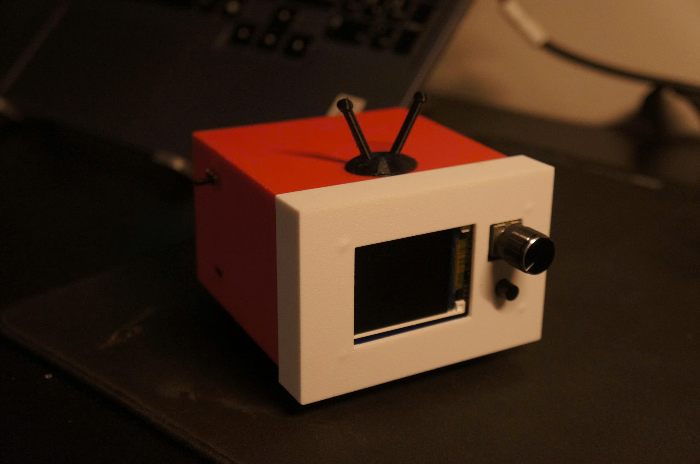
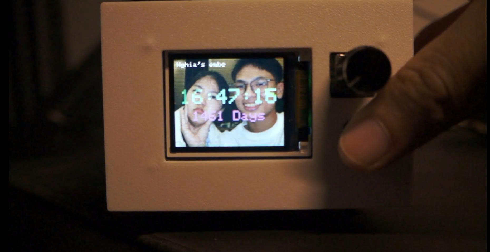
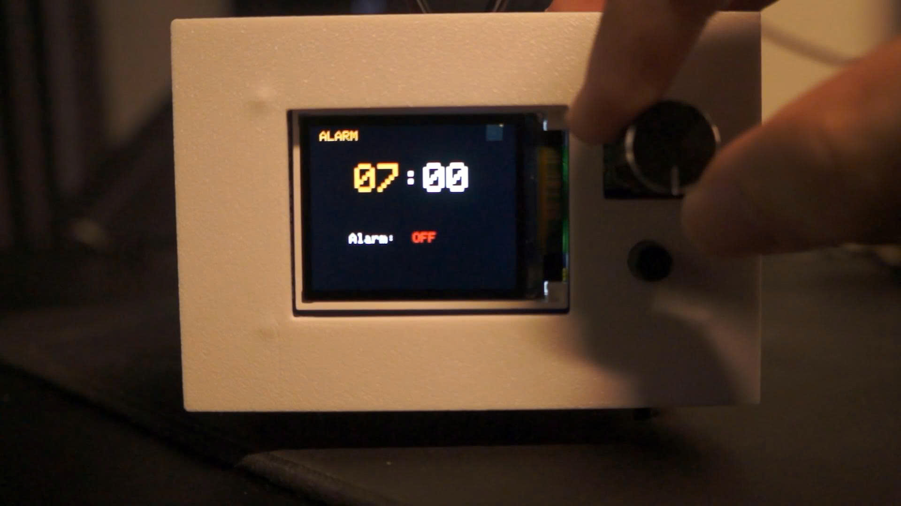
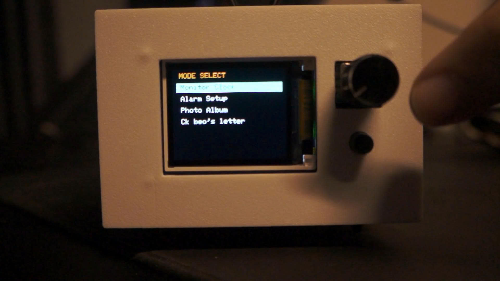
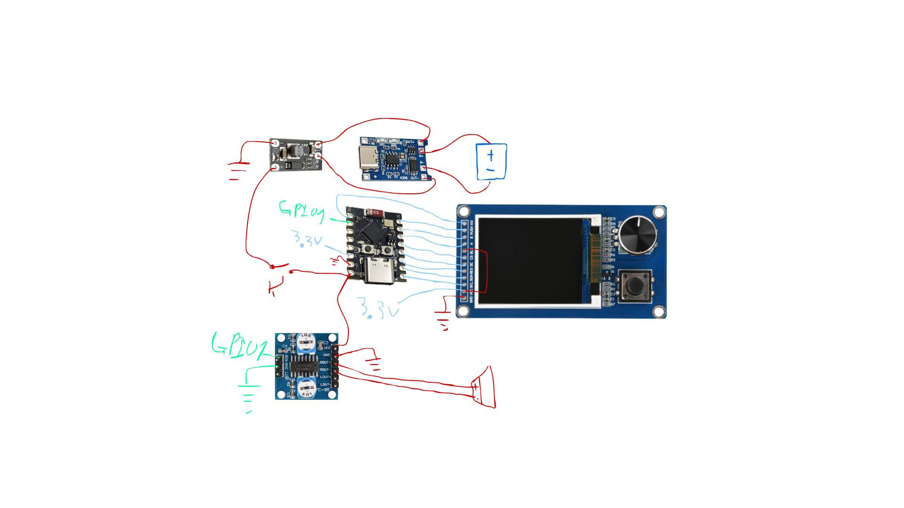
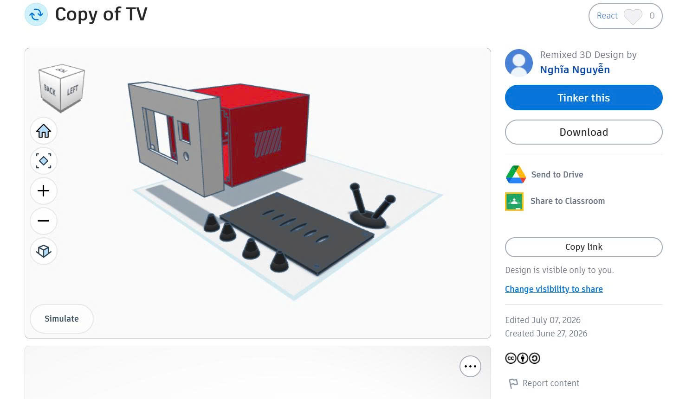

# ESP32-C3 Smart Desk Clock & Photo Display

A multifunctional embedded device developed using ESP32-C3 and an LCD display. The device combines several everyday features into a compact, custom-designed product.

## Project Overview

This project involves the development of a multifunctional smart desk device with the following features:

- **Digital Clock:** Displays the current time.
- **Photo Album:** Displays a collection of personal photos.
- **Alarm Clock:** Provides an alarm function.
- **Relationship Day Counter:** Calculates and displays the number of days since a specified date.

The project covers hardware assembly, firmware development, and custom 3D enclosure design.

## Product Showcase

*Device displaying its functions*

## Hardware Components

| Component | Description |
|---|---|
| Microcontroller | ESP32-C3 mini |
| Display | Pcbfun TFT 1,8 inch + EC11 |
| Enclosure | Custom 3D-printed case |
| Speaker | Pcbfun 3525 3w 4ohm |
| Charge module | TP4056 |
| Battery | Lithium 3.7V |
| Amplifier module | PAM8406 |
| Transformer circuit | 5v 8v 9v 12v |

*Additional components and specifications will be documented as needed.*

## Hardware Development

- Assembled electronic components and performed hardware wiring.
- Conducted soldering and physical connections.
- Integrated the hardware components with the ESP32-C3 firmware.

## Firmware Development

- Developed firmware for the device's main functions.
- Used AI-assisted coding tools to support code development and debugging.
- Integrated the clock, photo album, alarm, and day counter functions.

Source code: [`monitor/monitor.ino`](monitor/monitor.ino)
Image code file: [`monitor/image.h`](monitor/image.h)

## 3D Enclosure Design

Designed a custom enclosure using Tinkercad to accommodate the electronic components and create a compact final product.

## Tools & Technologies

- **Microcontroller:** ESP32-C3 mini
- **Programming:** C/C++ 
- **Development Tools:** Arduino IDE 
- **3D Design:** Tinkercad
- **Hardware Skills:** Soldering, Wiring, Hardware Assembly
- **Development Support:** AI-assisted Coding

## Project Status

**Completed** – The device has been assembled, enclosed, and tested as a functional product.

## Author

**Nguyen Chinh Nghia**

Automation Engineering Student  
Ho Chi Minh City University of Technology (HCMUT)
